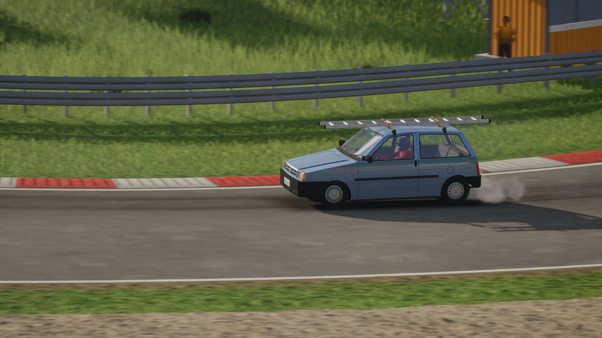
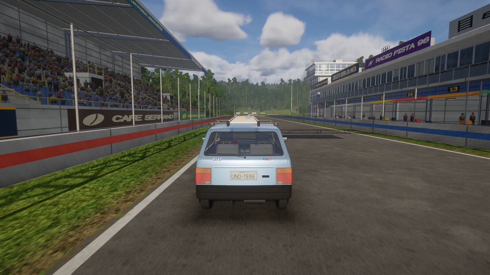
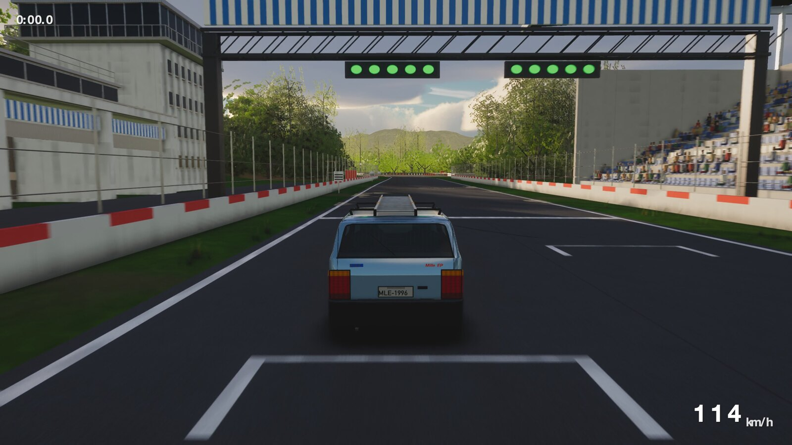
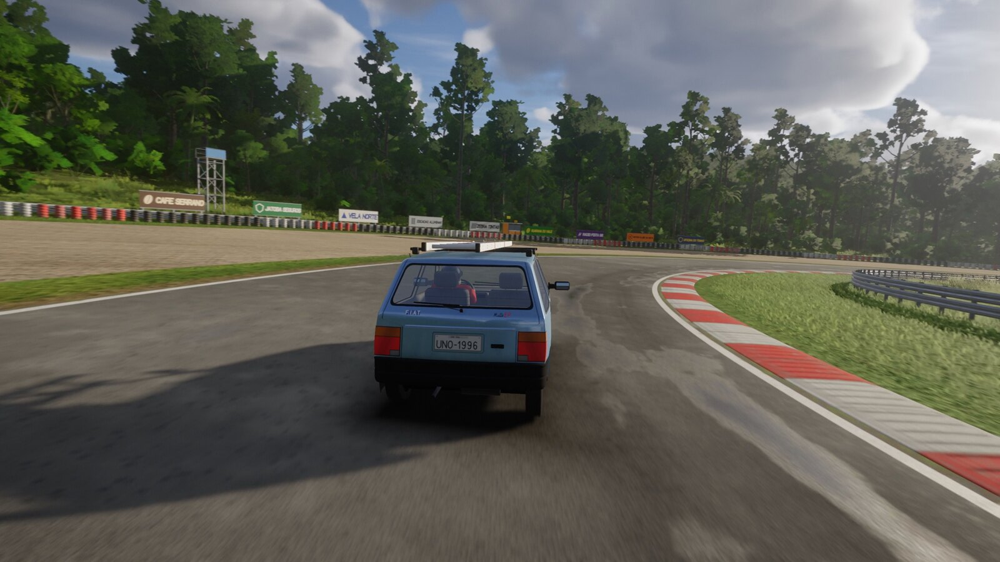
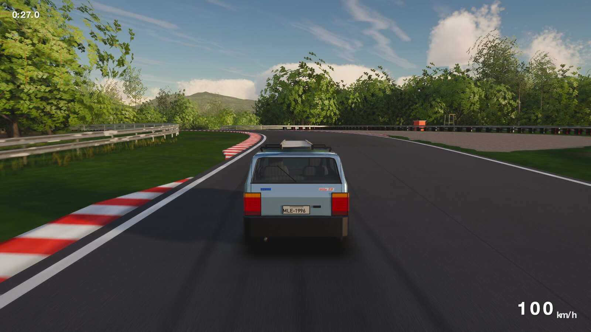

# Uno with a Ladder

**A 1996 Fiat Uno Mille EP with an aluminium ladder on the roof, to drive round a racing circuit, right in the browser. This fork adds two Aston Martins with film-style gadgets, a DB5 (1964) and a V8 Vantage (1987), and a second map: Weston-super-Mare, built from OpenStreetMap.**

There are two versions of the same game, made by two AI models from the same request: one by Claude Fable 5.2 and one by Claude Opus 5.5. Each version is a single `index.html`. The car, track, forest, sky and sound all come from code: neither uses textures, recorded audio, a game engine or a 3D library. (The exceptions are in the Fable version: the DB5 and the V8 are modelled in Blender, and Weston-super-Mare is baked from OpenStreetMap and elevation data, all stored in the page as compressed data.)



The project started in a video on the [ViktorKav](https://www.youtube.com/@vkav) channel about how to write a request for an AI. The video's companion material is at [viktorkav.com.br/apoio/uno-com-escada](https://viktorkav.com.br/apoio/uno-com-escada/).

## Play

**On Windows, as an installed game:** download [`dist/Uno-with-a-Ladder-DB5-Edition.zip`](dist/Uno-with-a-Ladder-DB5-Edition.zip), right-click it > **Extract All**, and double-click **`Install.cmd`**. It installs for your user only (no admin rights), adds desktop and Start-menu icons and an entry in Settings > Apps, and starts the game. `Play.cmd` runs it without installing. macOS and Linux launchers are in the zip too.

**In the browser:**

1. Download [`fable/index.html`](fable/index.html) or [`opus/index.html`](opus/index.html).
2. Open the file in **Chrome** or **Edge** on a computer.
3. Wait a few seconds while the circuit is built, then press **Start**.

There is nothing to install and the page works offline. It needs a browser with **WebGPU** (Chrome or Edge 113 or newer). The original target was a MacBook Pro M4 Max at 2560×1440; on more modest machines the frame rate drops. In the Fable version, **Fast graphics** (in the menu) draws at 720p for laptops and older PCs, and the game switches to it by itself if the graphics card is too slow.

The original versions, without the DB5, can be played online:

- [Fable 5.2 version](https://viktorkav.com.br/apoio/uno-com-escada/fable/)
- [Opus 5.5 version](https://viktorkav.com.br/apoio/uno-com-escada/opus/)

## The two versions

| | Fable 5.2 | Opus 5.5 |
|---|---|---|
| Game name | Uno with a Ladder | Mille EP |
| Circuit | Serra da Mata | Serra Circuit |
| Working time | 7 h 12 min | 5 h |
| Visual-critic rounds | 8 | 11 |
| Serious defects in the last round | 4 | 5 |
| API price | US$ 347.64 | US$ 87.81 |
| Size when the test was delivered | 546 KB | 338 KB |
| Size with sound and menu | 603 KB | 341 KB |

| Fable 5.2 | Opus 5.5 |
|---|---|
|  |  |
|  |  |

Both models ran at high effort, each with its own visual critic, with no limit on rounds or time. **Neither met the definition of done:** the request only counted the task as finished when the critic found nothing worse than a minor defect, and both still had a serious defect in their last round. Opus stopped on its own at round 11, saying the task was not finished. Fable was interrupted at round 8.

## Controls

Both games take the same commands. The list is also on the start screen.

| | Keyboard | Gamepad |
|---|---|---|
| Throttle | `W` or `↑` | Right trigger |
| Brake and reverse | `S` or `↓` | Left trigger |
| Steer | `A` `D` or `←` `→` | Left stick |
| Handbrake | `Space` | `A` |
| Change camera | `C` | `Y` |
| Look back | Hold `V` | Hold `RB` |
| Put the car back on the track | `R` | `X` |
| Pause and open the menu | `Esc` | `Start` |

| Tool | Key |
|---|---|
| Sound on and off | `M` |
| Performance stats | `H` |
| Benchmark: the scripted 60 s lap, with average and maximum at the end | `B` |
| Watch the scripted lap | `F` |
| Fixed camera poses | `1` to `6` (`7` with the DB5) |

The gearbox is automatic, and a lap counts when the car crosses the start line. The sound starts after the first click.

### The Aston Martin DB5 (Fable version)

Pick the car on the start screen (or open the page with `?car=db5`, `?car=v8` or `?car=uno`). The DB5 and the V8 add a cockpit camera to the `C` cycle. The DB5's gadgets:

| Gadget | Keyboard | Gamepad |
|---|---|---|
| Revolving number plates | `P` | D-pad ← |
| Machine guns (hold) | `G` | `B` |
| Rear bullet shield | `K` | D-pad ↑ |
| Tyre slashers | `T` | D-pad → |
| Bumper rams | `U` | Back |
| Smoke screen | `J` | `LB` |
| Oil slick (hold) | `O` | D-pad ↓ |
| Ejector seat | `E` | `R3` |
| Horn (hold) | `Q` | `L3` |
| Headlamps | `L` | |

Its physics use the homologated figures (FIA form no. 186: 3995 cc straight-six, 282 bhp at 5500 rpm, ZF five-speed gearbox, 2489 mm wheelbase, 6.70×15 tyres), and its engine and gadget sounds are synthesised live like the Uno's.

### The Aston Martin V8 Vantage (Fable version)

The 1987 car, as winterised for the film, with these gadgets:

| Gadget | Keyboard | Gamepad |
|---|---|---|
| Hubcap lasers (hold) | `G` | `B` |
| Missiles from behind the driving lamps (two per load, 10 s to reload) | `K` | D-pad ↑ |
| Spiked tyres | `T` | D-pad → |
| Outrigger skis | `U` | Back |
| Rocket booster (3 s of thrust, 15 s to recharge) | `J` | `LB` |
| Self-destruct (hold 2 s; the car comes back on the track) | `E` | `R3` |
| Horn (hold) | `Q` | `L3` |
| Headlamps | `L` | |

The head-up display shows in the cockpit view while the weapons are in use. The physics follow published figures (2610 mm wheelbase, 5340 cc V8, about 400 bhp, ZF five-speed, 255/60 VR15 tyres), and its V8 is synthesised live with a cross-plane firing order.

### Weston-super-Mare (Fable version)

Pick the map on the start screen (or `?map=wsm`). The town is built from OpenStreetMap: real streets and building footprints, terrain from elevation data, the beach, the Marine Lake and the Grand Pier. Laps run on a 3.5 km street circuit (Royal Parade, Knightstone Road, the Boulevard, Alexandra Parade, Station Road, Walliscote Road, Beach Road), and you can leave it to drive anywhere in town. The bake script is [`tools/osm/bake_wsm.py`](tools/osm/bake_wsm.py).

## How it was made

The [`prompts`](prompts) folder has the text the AI received, uncut (translated into English):

| File | What it is |
|---|---|
| [`01-circuit.txt`](prompts/01-circuit.txt) | The game request: priorities in order, constraints, target machine, scene, three checks (visual critic, performance and controls) and the definition of done. The same text went to Fable 5.2 and Opus 5.5. |
| [`02-sound-and-menu.txt`](prompts/02-sound-and-menu.txt) | The next request: gamepad, dashboard, start screen, menu, benchmark and synthesised sound. It went to Fable 5.2 in both games, after the test. |
| [`03-adjustments.txt`](prompts/03-adjustments.txt) | Three final text and volume adjustments. |

The visual critic in the first request is a fresh subagent every round, which only sees the game's images and the references, never the code. The car photos and screenshots used as image references are not part of this repository.

The shape of the request comes from [Abyssal Garden](https://github.com/Noniv/abyssal-garden), by Noniv: a 97 KB 3D ocean made the same way.

## Working on the code

Each version's readable code is in its `source` folder. To change something and rebuild the `index.html`, all you need is [Node.js](https://nodejs.org) 18 or newer, with no packages to install:

```bash
node fable/source/build.mjs
node opus/source/build.mjs
```

Each command rewrites that version's `index.html`. `sh packaging/make_zip.sh` builds the Windows zip in `dist/`.

**Fable version** ([`fable/source`](fable/source)): the files in `js/` go into the page in filename order.

| File | What's inside |
|---|---|
| `js/10_track.js` | The circuit: layout, elevation and zones. **A good place to start.** |
| `js/29_db5_data.js`, `js/29_v8_data.js` | The DB5 and V8 meshes, generated by Blender (see below) |
| `js/30_car_*.js` | The Uno (body shape, paint, parts, rack and ladder) and the DB5 and V8 loaders |
| `js/31_world.js`, `js/32_props.js` | Terrain, track, guard rails, grandstand, pits and gantry |
| `js/33_veg_*.js` | The forest: trees, grass and the far-away impostors |
| `js/40_vehicle.js` | The car physics |
| `js/41_gadgets*.js` | The DB5's and the V8's gadgets |
| `js/12_wsm_data.js`, `js/13_wsm_town.js`, `js/34_wsm_world.js` | Weston-super-Mare: baked map data, town builder, world |
| `js/45_game.js` | Input, cameras and the scripted lap |
| `js/50_som.js` | The sound, synthesised live |
| `js/51_painel.js`, `js/52_ui.js` | Dashboard, start screen, menu and benchmark |
| `wgsl/` | The shaders: materials, sky, shadows, post-processing |
| `blender/` | The DB5's and V8's Blender models, built from measurements by Python scripts (see [`blender/README.md`](fable/source/blender/README.md)) |

**Opus version** ([`opus/source`](opus/source)):

| File | What's inside |
|---|---|
| `js/track.js` | The circuit. **A good place to start.** |
| `js/car_model.js`, `js/cargfx.js` | The Uno and its GPU meshes |
| `js/world.js`, `js/terrain.js`, `js/vegetation.js` | Track, terrain and forest |
| `js/physics.js` | The car physics |
| `js/game.js` | Loading, main loop, input and cameras |
| `js/som.js` | The sound, synthesised live |
| `js/painel.js` | The in-game dashboard |
| `js/renderer.js`, `shaders/` | The renderer and the shaders |

## Credits

- DB5 body proportions measured from the "1965 Aston Martin DB5 Coupe" blueprint by [getoutlines.com](https://getoutlines.com/blueprints/12592/1965-aston-martin-db5-coupe-blueprints), licensed [CC BY 4.0](https://creativecommons.org/licenses/by/4.0/), and from FIA/RAC homologation form no. 186.
- V8 Vantage body proportions measured from the "1983 Aston Martin V8 Vantage" blueprint by [getoutlines.com](https://getoutlines.com/blueprints/13815/1983-aston-martin-v8-vantage-coupe-blueprints), licensed [CC BY 4.0](https://creativecommons.org/licenses/by/4.0/).
- Weston-super-Mare: map data © [OpenStreetMap contributors](https://www.openstreetmap.org/copyright) (ODbL). Contains Environment Agency information © Environment Agency and/or database right (LIDAR, Open Government Licence v3.0). Terrain: AWS Terrain Tiles (Mapzen/Tilezen): UK terrain data © Environment Agency copyright and/or database right 2015; SRTM and GMTED2010 courtesy of the U.S. Geological Survey; ETOPO1 from NOAA; EU-DEM produced using Copernicus data.
- This is an unofficial, non-commercial fan project. Aston Martin, DB5 and Vantage are trademarks of Aston Martin Lagonda Ltd; the project is not affiliated with or endorsed by Aston Martin or by the makers of the James Bond films.

## Licence

[PolyForm Noncommercial 1.0.0](LICENSE.md): free to use, study, change and share for non-commercial purposes.
